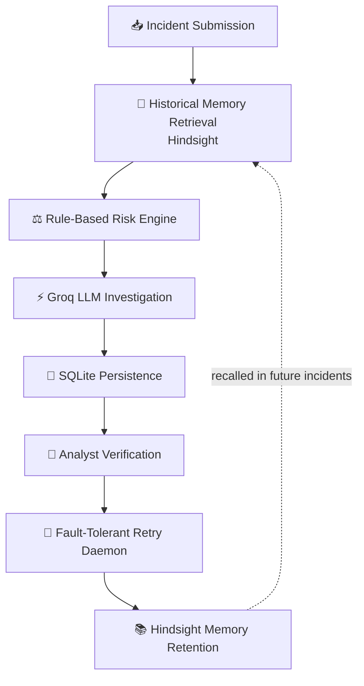
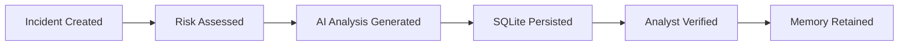

<div align="center">

# 🛡️ RECALLIX

### AI Security Incident Intelligence with Persistent Memory

**An AI-powered incident triage platform that combines a deterministic risk engine, LLM reasoning, outcome-aware long-term memory, and fault-tolerant background processing.**

*Investigate · Analyze · Recall · Retain*

<br/>

🐍 [**Python**](https://python.org) &nbsp;•&nbsp; ⚡ [**FastAPI**](https://fastapi.tiangolo.com) &nbsp;•&nbsp; ⚛️ [**React**](https://react.dev) &nbsp;•&nbsp; 🎨 [**Tailwind CSS**](https://tailwindcss.com) &nbsp;•&nbsp; 📄 [**MIT License**](LICENSE)

</div>

---

## 📑 Table of Contents

- [Overview](#-overview)
- [Key Features](#-key-features)
- [How It Works](#-how-it-works)
- [Core Intelligence Layers](#-core-intelligence-layers)
- [Incident Lifecycle & States](#-incident-lifecycle--states)
- [Dashboard](#-dashboard)
- [Project Structure](#-project-structure)
- [Tech Stack](#-tech-stack)
- [Getting Started](#-getting-started)
- [Build Challenges](#-build-challenges--lessons-learned)

---

## 📌 Overview

Traditional incident investigation tools analyze events using only the indicators visible *right now*. Once an investigation closes, its findings end up buried in logs, databases, or single-use tickets.

That creates real operational problems:

| Problem | Impact |
|---|---|
| 🔁 Similar attacks recur weeks later | Analysts repeat the investigation from scratch |
| 🎲 ML probabilities lack structure | Scores are hard to explain or audit |
| ⏱️ AI calls fail or hit quota limits | Synchronous workflows break mid-investigation |
| 🔗 Retained knowledge loses its origin | No traceability back to the source incident |

**RECALLIX** closes these gaps by combining:

- ⚖️ a **rule-based risk engine** for objective severity scoring
- ⚡ **Groq-hosted LLM reasoning** for structured investigation reports
- 🧠 **Hindsight** long-term memory for cross-incident recall
- 👤 **human-in-the-loop** analyst verification
- 🔄 an **asynchronous retry daemon** for fault tolerance

---

## ✨ Key Features

- **Deterministic severity scoring**, fully separate from AI output, so the LLM can never dictate threat levels
- **Structured AI dossiers** returned in an enforced JSON schema
- **Memory-aware investigations** that compare new incidents against verified past ones
- **Idempotent memory retention**, so there are no duplicates even if verification is committed twice
- **Graceful degradation**: quota limits and network failures fall back to rule-based metrics
- **Persistent reports** stored in SQLite, surviving refreshes and navigation
- **Audit-friendly memory cards** grouped by their original `Source: INC-ID`
- **Dark SOC-style dashboard** built for fast scanning

---

## 🔄 How It Works



---

## 🧠 Core Intelligence Layers

RECALLIX uses a multi-layered framework to keep data trustworthy across the whole incident lifecycle.

### 1️⃣ Rule-Based Risk Engine

To stop LLM hallucination from influencing threat metrics, severity comes from a deterministic rules pipeline that inspects evidence length and incident classification.

| Rule | Score Contribution |
|---|---:|
| Base match score | **40%** |
| Multi-vector incident | **+20%** |
| Identity compromise affected | **+20%** |

The final score maps to a tier: `LOW` · `MEDIUM` · `HIGH` · `CRITICAL`, entirely independent of the AI reasoning loop.

### 2️⃣ Groq AI Investigation Module

Uses `llama-3.3-70b-specdec` through Groq's high-speed inference to produce a structured breakdown of evidence gaps and next steps.

**Enforced JSON response schema:**

| Field | Purpose |
|---|---|
| `executive_summary` | Concise incident narrative |
| `evidence_analysis` | Line-by-line validation of the evidence |
| `historical_comparison` | Matches against past Hindsight knowledge |
| `uncertainties` | Known evidence gaps or validation failures |
| `next_investigation_steps` | Actionable containment sequence |
| `analyst_guidance` | Investigation protocols for the analyst |

### 3️⃣ Hindsight Long-Term Memory

Instead of treating incidents as isolated artifacts, RECALLIX queries a local **Hindsight** microservice (`127.0.0.1:8889`) against a dedicated memory bank.

When an analyst clicks **Commit Verification**, an idempotent document signature is submitted:

```text
recallix-verified-incident-{id}
```

This gives stable, duplicate-free, cross-incident recall with full traceability.

---

## ⚙️ Incident Lifecycle & States



### Response States & Recovery

| State | Meaning | Recovery Action |
|:---:|---|---|
| ✅ `completed` | AI reasoning compiled and saved locally | Ready for analyst audit sign-off |
| ⚠️ `quota_limited` | Upstream token limit hit (HTTP 429) | Falls back safely to deterministic rule metrics |
| 🔌 `connection_error` | Upstream provider unreachable | Workspace held in local DB for later retry |

---

## 🖥️ Dashboard

A custom dark-themed Security Operations Center UI with sub-300ms view transitions.

| Feature | Description |
|---|---|
| 🟢 **Engine Status Checker** | Pings the backend root endpoint `/` and shows `● System online` instead of false offline errors |
| 📄 **Persistent AI Dossier** | Reports are string-serialized into SQLite columns, so they survive page refreshes and view changes |
| 🗂️ **Traceable Memory Cards** | Retrieved history is grouped by original `Source: INC-ID` to preserve audit trails |

---

## 🏗️ Project Structure

```text
Recallix-security-intelligence/
│
├── backend/
│   └── app/
│       ├── database/
│       │   └── database.py
│       ├── models/
│       │   └── incident.py
│       ├── memory/
│       │   └── hindsight_service.py
│       ├── routes/
│       │   └── incidents.py
│       ├── services/
│       │   ├── investigation_engine.py
│       │   └── llm_service.py
│       └── main.py
│
├── frontend/
│   ├── src/
│   │   ├── components/
│   │   │   ├── AIInvestigationReport.jsx
│   │   │   └── MemoryCard.jsx
│   │   ├── services/
│   │   │   └── api.js
│   │   ├── App.jsx
│   │   └── index.css
│   ├── package.json
│   └── vite.config.js
│
├── requirements.txt
├── recallix.db
└── README.md
└── article.md
```

---

## 🛠️ Tech Stack

| Layer | Technologies |
|---|---|
| **Backend** | 🐍 Python · ⚡ FastAPI · 🧱 SQLAlchemy · 🗄️ SQLite |
| **AI & Memory** | 🤖 Groq (`llama-3.3-70b-specdec`) · 🧠 Hindsight |
| **Frontend** | ⚛️ React · ⚡ Vite · 🎨 Tailwind CSS |

---

## 🚀 Getting Started

### Prerequisites

- Python 3.10+
- Node.js 18+
- A [Groq API key](https://console.groq.com)
- A running Hindsight service at `127.0.0.1:8889`

### 1. Clone the repository

```bash
git clone https://github.com/YOUR_USERNAME/Recallix-security-intelligence.git
cd Recallix-security-intelligence
```

### 2. Set up the backend

```bash
python -m venv .venv

# Windows
.venv\Scripts\activate
# Linux / macOS
source .venv/bin/activate

python -m pip install --upgrade pip
pip install -r requirements.txt
```

Create a `.env` file in the project root:

```env
GROQ_API_KEY=your_secret_groq_api_token
GROQ_MODEL=llama-3.3-70b-specdec
HINDSIGHT_BASE_URL=http://127.0.0.1:8889
HINDSIGHT_BANK_ID=security-incident-intelligence
```

> ⚠️ Never commit your `.env` file. Make sure it is listed in `.gitignore`.

Start the API server:

```bash
uvicorn backend.app.main:app --reload --port 8000
```

### 3. Launch the frontend

```bash
cd frontend
npm install
npm run dev
```

Open **http://localhost:5173** in your browser.

---

## 🧩 Build Challenges & Lessons Learned

### 1. SQLite Data Serialization Drops

**Problem:** SQLAlchemy's standard JSON column returned raw, unparsed strings on fast reloads when queried through basic dictionaries, which broke frontend layout components.

**Solution:** AI reports are explicitly serialized to strings before storage and parsed on retrieval, so the dossier stays intact across refreshes.

<!-- Add more challenges here -->

---

<div align="center">

**Built to make every investigation count.** 🛡️

*If RECALLIX helps you, consider giving it a ⭐*

</div>
